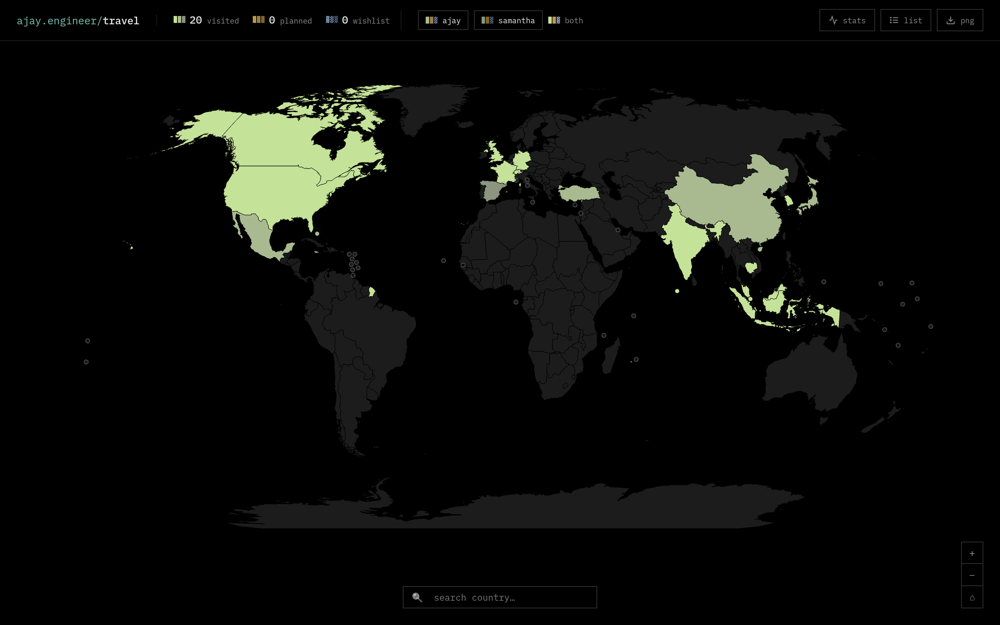

# ajay.engineer/travel

Where I've been, where I'm going next, and where I'd like to go — on a world map.

Live at **[ajay.engineer/travel](https://ajay.engineer/travel/)**.



## Updating the map

Edit `data.json` and push to `main`; GitHub Pages redeploys.

```json
{
  "statuses": { "IND": "visited", "JPN": "planned", "NZL": "wishlist" },
  "details": {
    "IND": { "rating": 5, "year": "2024", "notes": "Delhi and Agra." }
  }
}
```

- Keys are ISO 3166-1 alpha-3 codes, as listed in `countries.json`.
- Statuses are `visited`, `planned` or `wishlist`.
- `details` is optional, and so is each of `rating` (1–5), `year` and `notes`.
- Unknown codes or statuses are ignored and listed in a browser-console warning.

## Development

```sh
git submodule update --init --recursive
make serve        # http://localhost:8000
make format       # run before pushing: CI checks formatting with `make ci`
make screenshot   # refresh screenshot.png from the local site (needs Chrome)
```

There's no build step. The site is `index.html`, `style.css`, `countries.json` and ES modules in `js/`. Deploys use the shared [ajay/site-common](https://github.com/ajay/site-common) workflow.
